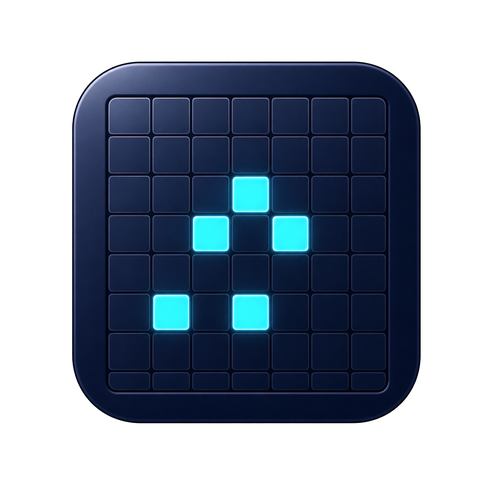

<!-- SPDX-FileCopyrightText: 2026 Greg Pfountz -->
<!-- SPDX-License-Identifier: GPL-3.0-only -->



# Conway's Game of Life

A native-feeling macOS desktop implementation of Conway's Game of Life, built with PySide6.

## License

Copyright (C) 2026 Greg Pfountz. The original project source is licensed under
[GNU GPL version 3 only](LICENSE) (`GPL-3.0-only`), with no warranty to the extent
permitted by law. You may modify and redistribute it under those terms.
See [licensing and contributions](LICENSING.md) for reuse guidance, material
exceptions, and binary distribution status, and the
[third-party notices](src/gameoflife/legal_texts/THIRD_PARTY_NOTICES.md) for separate
dependency terms. The app's **About Conway's Game of Life** dialog provides offline legal texts.

## Development Run

The reviewed dependencies require Python 3.11–3.14 and macOS 13 or later.
Qt is constrained below 6.12 to retain macOS 13 wheels; its package layout and
platform requirements need a separate review before that bound is removed.
PyObjC Core and Cocoa use version 13 or later, which requires Python 3.11 or later.
From the project checkout, create a local
virtual environment and install the dependencies:

```zsh
python3 -m venv .venv
.venv/bin/python -m pip install --upgrade pip
.venv/bin/python -m pip install -e ".[dev]"
```

After the initial setup, launch app with:

```zsh
.venv/bin/conways-game-of-life
```

run all tests with:

```zsh
.venv/bin/python -m pytest -q
```

Check required legal resources and preserved upstream notices with:

```zsh
.venv/bin/python scripts/check_legal_resources.py
```

run one test with:

```zsh
.venv/bin/python -m pytest -q tests/test_life.py::test_blinker_oscillates
```

run ruff python linter tests with:

```zsh
.venv/bin/python -m ruff check src tests; .venv/bin/python -m mypy --strict src tests
```

## Deployment

After `git pull`, run the same command for a first installation or an update:

```zsh
./scripts/deploy.sh
```

The script installs into `~/Applications/Conways Game of Life.app`. It detects
whether that bundle already exists and reports **Install** or **Update**.
Each run builds the current checkout, even when its application version has not
changed. Quit the installed application before updating it.

Before building, deployment reuses the checkout's `.venv` (or creates it if
missing) and runs its Python's `pip install --requirement requirements.txt`.
This installs missing dependencies and adjusts versions to satisfy the checked-in
requirements, including the Qt upper bound. It does not request blanket upgrades,
change requirements, or generate a lockfile; already satisfied requirements stay
installed. The repository currently uses version ranges rather than a lockfile.
It then runs `pip check` and the existing legal-resource verification, including
the canonical GPL copy and preserved upstream notice hashes in `SOURCES.json`.
Installation or validation failures stop before the build and leave the installed
application untouched. The checkout's `.venv` may have been updated; fix the
reported error and rerun the same command.

Deployment then builds a wheel from a clean temporary source copy, checks its legal
resources, and installs it and the same requirements into a fresh bundle environment.
It refreshes the launcher, icon, and version metadata, then checks imports and
installed dependencies. An update keeps the old bundle until the replacement
passes verification; if verification fails after replacement, it restores the
old bundle. Temporary build files are cleaned up automatically.

Preview the detected action without changing files or downloading dependencies:

```zsh
./scripts/deploy.sh --dry-run
```

Launch the application after a successful deployment, or choose another location:

```zsh
./scripts/deploy.sh --open
./scripts/deploy.sh --app-path "/path/to/Conways Game of Life.app"
```

Use Python 3.11–3.14 on macOS 13 or later. The shell wrapper starts with
`.venv/bin/python` when available, otherwise `python3`; select the bootstrap
interpreter with `DEPLOY_PYTHON=/path/to/python3 ./scripts/deploy.sh`.
Dependency installation and building always use the checkout's `.venv/bin/python`;
an existing `.venv` is reused even when `DEPLOY_PYTHON` is set. An incomplete or
symlinked `.venv` is rejected. Dry-run only reports the planned stages and does
not create or modify the environment, install dependencies, build, or launch.
Internet access is needed for
build tools and dependencies unless they are already available through pip.
The installed bundle depends on that external Python installation remaining
available. This is a local installation workflow; see [LICENSING.md](LICENSING.md)
for the separate requirements for distributing binaries.

`./scripts/redeploy.sh` delegates to `scripts/deploy.sh` and accepts the same options.

## Controls

- Click or left-drag across cells to toggle them alive or dead; a cell toggles only once per stroke.
- Right-click or middle-drag to pan the infinite grid.
- Scroll to zoom in and out.
- Arrow keys pan the grid four cells at a time.
- `Space`: run or pause.
- `S`: advance one generation.
- `N`: new randomized universe.
- `C`: clear the grid.
- `=` / `-`: zoom in / out.
- `0`: center the pattern.
- '1', '2', '3': slow, medium, fast speed

Use **Patterns** for classic built-in configurations including still lifes, oscillators, a glider, and Gosper's glider gun.

## Rules

The game follows Conway's B3/S23 rule: live cells survive with two or three live neighbors; dead cells are born with exactly three live neighbors. Updates are simultaneous and the universe is represented as an unbounded sparse set of live cells.
